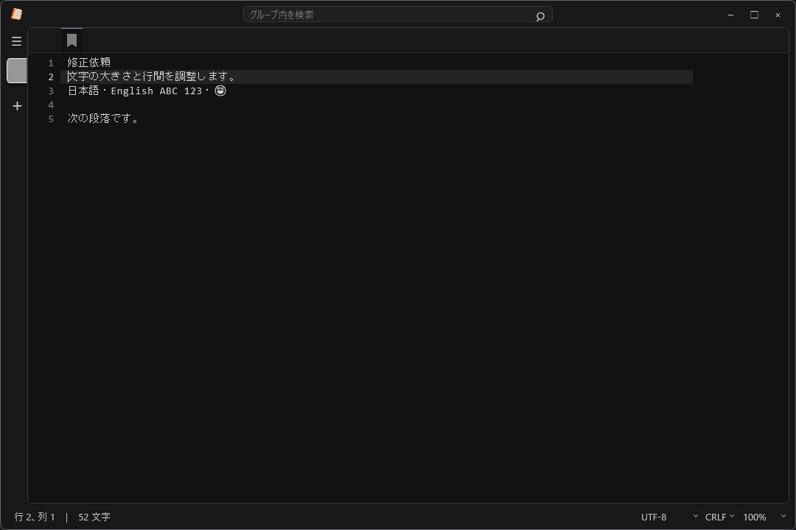

# Folipera

付箋とラベルでメモを整理する、Windows向けのテキストメモアプリです。
インストール不要の **0.1.9** を配布します。

## ダウンロード・起動

1. このリポジトリの **Releases** から `Folipera.zip` をダウンロードします。
2. ZIPをフォルダへ展開します。
3. `Folipera.exe` を起動します。`Folipera.exe.config` と `ICSharpCode.AvalonEdit.dll` は同じフォルダに置いてください。

Windowsと **.NET Framework 4.8** が必要です。アプリ自身の通信機能、アカウント登録、外部ライブラリの追加インストールはありません。実行ファイルにコード署名は付与していません。

更新する場合はFoliperaを終了し、ZIP内の配布ファイル一式を既存のフォルダへ上書きしてください。作業記録はアプリのフォルダとは別の場所に保存しています。

## 主な機能

- 左の付箋でグループを分け、上のラベルタブで複数のメモを切り替え
- ラベルのドラッグによる並べ替え、固定、閉じたメモの開き直し
- ダーク／ホワイトテーマと、モノクロ・春・夏・秋・冬のラベル配色
- 新規作成、開く、保存、名前を付けて保存、最近使ったファイル、ファイルのドロップ
- 検索・置換、全一致箇所の強調、大文字小文字・単語単位・正規表現検索
- `【】`・`「」`・`『』`・`（）`・`[]`・`{}`などの内側をダブルクリックして、中の文字全体を選択（入れ子・複数行にも対応）
- 現在のグループ、開いている全メモ、ローカルフォルダをまとめて検索
- 未保存の文章、タブ、カーソル・スクロール位置、表示設定の復元
- 自動バックアップと過去の版の復元
- フォント、文字サイズ、折り返し、表示倍率、文字数・行番号
- 文字コードと改行形式の確認・変更
- 2つのメモの分割表示、Markdownプレビュー・見出し一覧
- 簡易コード色分け、括弧の強調、インデント設定、行の移動・複製、複数カーソル
- 日時挿入、定型文の登録、ミニマップによる文書内の移動

## 操作の目印

左上の「☰」から各メニューを開きます。左の「+」はグループの追加、Ctrl+Nは現在のグループへのメモの追加です。ラベル列の空白を右クリックしても新しいメモを作れます。

新しいメモ・付箋グループを作ると、そのメモの入力欄へフォーカスが移り、本文をクリックせずに入力できます。日本語変換中の縦線は変換文字の末尾に表示し、未変換の文字を途中で編集するときは実際のカーソル位置を示します。

タブにはファイル名の代わりにラベルを表示し、マウスを重ねると名前・保存先・変更状態を確認できます。保存先のあるメモのファイル名は、ウィンドウ左上にも表示します。

ラベルを右クリックすると固定・固定解除・閉じる・移動・分割を選べます。固定タブはピンになって左にまとまり、ドラッグ・中央クリック・Ctrl+Wの対象外になります。右クリックの「タブを閉じる」では閉じられます。

付箋を右クリックするとグループを閉じられます。グループ内のメモもまとめて閉じる前に確認します。アクティブの付箋は縁取りと明るい色、非アクティブは暗い色で表示します。

本文と行番号の標準サイズは14px、1行の高さは19pxです。標準フォントでは英数字にConsolas、日本語の補完にMS ゴシックを指定し、通常の太さで表示します。選択中のフォント・太さ・文字サイズは保ったまま、字間を100%時に0.6px追加します。字間は表示倍率に合わせて拡大・縮小します。未確定の日本語も本文と同じ明暗テーマで表示し、変換対象を下線で示します。入力フォーカスがあるメモのカーソル行は薄い背景色で示し、その行番号も強調表示します。折り返した行は同じ論理行として強調します。文字サイズや表示倍率を変えると行間も一緒に拡大・縮小します。以前の標準設定（Consolas・16px）は初回の更新起動時に14pxへ移行します。独自のフォント・文字サイズと表示倍率は引き継ぎます。

上中央の枠はグループ内検索です。右下では文字コード・改行形式・表示倍率を変更できます。表示倍率は25〜400%の数値入力にも対応します。

## よく使うキー

| 操作 | キー |
| --- | --- |
| 新しいメモ／開く | Ctrl+N／Ctrl+O |
| 保存／名前を付けて保存 | Ctrl+S／Ctrl+Shift+S |
| タブを閉じる／次のタブ | Ctrl+W／Ctrl+Tab |
| 閉じたタブを開き直す | Ctrl+Shift+T |
| 元に戻す／やり直す | Ctrl+Z／Ctrl+Y |
| 検索 → 置換 → 閉じる | Ctrl+Fを押すごとに切り替え |
| 置換欄を直接開く | Ctrl+H |
| 次／前の一致箇所 | 検索欄でEnter／Shift+Enter |
| まとめて検索 | Ctrl+Shift+F |
| 指定行へ移動／日時挿入 | Ctrl+G／F5 |
| メモ一覧 | Ctrl+Shift+E |
| 拡大・縮小／100%へ戻す | Ctrl+マウスホイール、Ctrl++・Ctrl+-／Ctrl+0 |
| Markdownプレビュー | Ctrl+Shift+V |
| 行の移動／複製 | Alt+↑・↓／Alt+Shift+↑・↓ |
| 次の同じ語／すべての同じ語を選択 | Ctrl+D／Ctrl+Shift+L |
| 追加カーソル／追加カーソルを解除 | Alt+クリック／Esc |
| 字下げ／字下げを戻す | Tab／Shift+Tab |

検索欄の `Aa` は大文字小文字、`ab` は単語単位、`.*` は正規表現です。置換では `$1` などのキャプチャを使えます。Escまたは×で検索欄を閉じます。

## 保存・復元・データの場所

**未保存内容の復元と、元ファイルへの保存は別の機能です。** 元ファイルの更新にはCtrl+S等の保存操作を使います。勝手に元ファイルを上書きしません。

×・Alt+F4・メニューからの通常終了では、メモごとの保存確認を出さず、未保存内容も作業記録へ保持します。次回の起動時に復元します。タブやグループを個別に閉じるときは、未保存内容の扱いを確認します。

作業記録の保存先は `%LOCALAPPDATA%\Folipera\` です。

| 内容 | 保存先 |
| --- | --- |
| タブ、設定、作業全体の記録 | `session.xml` |
| 編集ごとに書き出す復元用の差分 | `recovery\` |
| メモごとの過去の版（新しい30版） | `history\` |

差分は変更ごとにディスクへ書き出し、作業全体は約2秒ごとにも記録します。強制終了後は有効な差分を読み戻します。書き込み途中や記録先の故障・停電まで含む完全な無損失は保証できません。

記録の書き込みに失敗すると、文章を画面に残して通知します。通常終了の直前に作業記録を保存できない場合は、終了を中止します。元ファイルが読めない場合は作業記録から戻し、他のメモの復元を続けます。

記録には文章・ファイルパスを含み、暗号化はしていません。記録先を削除すると未保存メモや履歴を失うため、残したい文章は通常のファイルとして保存してください。不具合報告にこのフォルダの内容をそのまま添付しないでください。

## 対応形式と現在の制限

- 文字コード：UTF-8、UTF-8 BOM、UTF-16 LE／BE、Shift_JIS（Windows CP932）
- 改行：CRLF、LF、CR。変更前の形式を確認でき、明示的に切り替えられます
- 32MBを超えるファイル、UTF-32、改行形式が混在するファイルは開きません
- 文字コードの自動判定はBOM → 厳密なUTF-8 → CP932です。誤判定された場合は、保存前に「ファイル → 文字コードを指定して開き直す」を使ってください
- コード色分けは簡易的な字句解析です。補完、構文エラー診断、ターミナル、デバッガ、Git連携はありません
- Markdownは見出し、強調、リスト、引用、コードブロック等に対応します。HTMLや外部画像を読み込むブラウザーではありません
- 長文の応答速度は文書・端末に依存します。日本語IMEは複数の入力方式で検証していますが、すべての製品・設定の組合せを保証するものではありません
- 印刷機能は実機での検証を行っていません

## 不具合報告

このリポジトリのIssuesへ、バージョン、Windowsのバージョン、再現手順、期待した動作と実際の動作を記載してください。文章・画像・ファイルパスに個人情報や機密情報を含めないでください。

## 利用条件とソースコード

配布アプリは利用できます。改変、無断再配布、他製品への流用、ロゴ・アイコンの流用には事前の許諾が必要です。詳しくは [LICENSE](LICENSE) を確認してください。

**Folipera独自のソースコードは非公開です。** この公開リポジトリは、利用案内と配布用Releaseのためのものです。独自のコード・素材への再利用許諾は付与していません。

同梱の編集ライブラリAvalonEditにはMITライセンスが適用されます。詳しくは [THIRD-PARTY-NOTICES.txt](THIRD-PARTY-NOTICES.txt) を確認してください。
